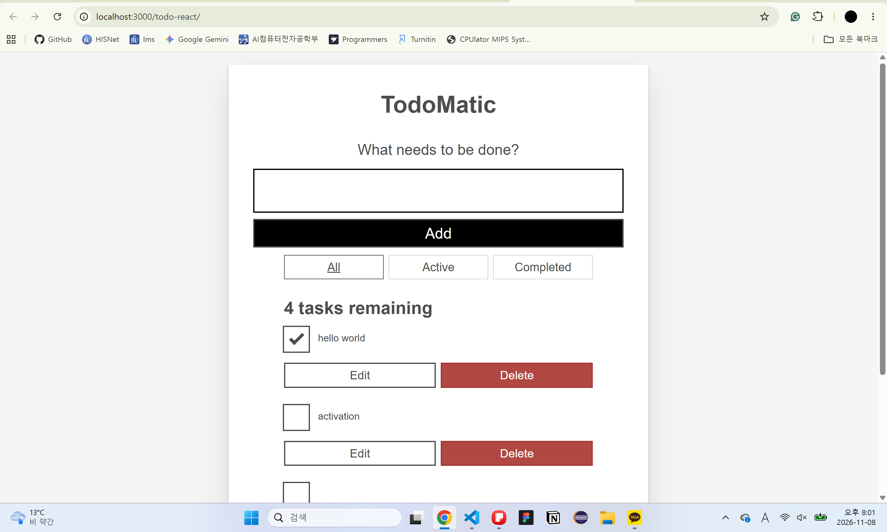

# Project Information: 프로젝트 소개, 선택 이유, 원본 GitHub URL 및 라이선스
이 프로젝트는 오늘 할 일을 정리하는 todo list 수정 프로그램이다. 체크를 누르면 오늘 한 일을 완성된 상태로 둘 수 있고, 체크 되지 않은 일은 active인 상태가 된다. 또한 삭제 버튼을 누르면 삭제되는 기능도 구현했다. 

- 선택 이유 
가장 간단하면서도, java script를 배울때 다루었던 crud의 기본 구성이 모두 들어있고, react로 CRUD 서비스는 어떻게 구현되는지 궁금해서 이 프로젝트를 선택했다. 그리고 

- 원본 github URL
https://github.com/mdn/todo-react.git
- 라이센스 
github의 LICENCE파일에 상세히 기록.

# Installation: 설치·실행 방법 및 실행 화면
설치 방법은 
1. 터미널에 git clone으로 파일을 불러온다.
git clone https://github.com/mdn/todo-react.git
2. cd <파일 이름> 을 통해서 현재 clone으로 만들어진 파일로 이동한다. 
3. npm install로 현재 필요한 필수 패키지를 설치해준다. 
4. npm run dev 명령어로 프로그램을 실행한다. 
-  실행화면
